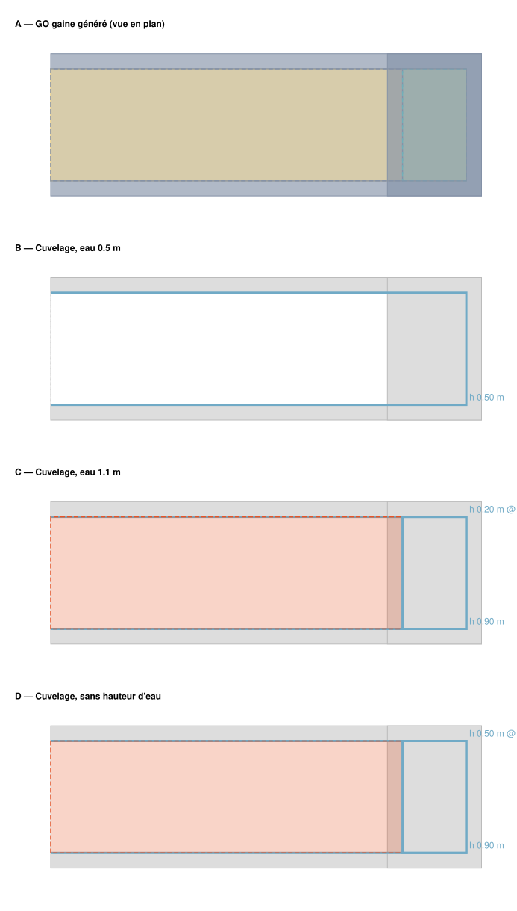

# Spec — Système « GO gaine » et procédure « Cuvelage gaine »

|                          |                                                                                                                                                      |
| ------------------------ | ---------------------------------------------------------------------------------------------------------------------------------------------------- |
| **Feature**              | Génération paramétrique du gros œuvre d'une gaine depuis un seuil 2 points, puis cuvelage de la gaine selon la hauteur d'eau                         |
| **Domaine**              | `annotationsAuto` (procédures `Data/edx/automatedAnnotationsProcedures/gaine/`), bibliothèques `GO_GAINE` / `CUVELAGE_GAINE`, objectsLibrary SYSTEMS |
| **Issue / branche**      | — (demande directe, 2026-10-14)                                                                                                                      |
| **Statut**               | Implémenté, tests node verts (2026-10-14) ; validation UI par l'utilisateur à faire                                                                  |
| **Exemple de référence** | [`example-annotations.json`](example-annotations.json) → [`expected-render.svg`](expected-render.svg)                                                |

> Le rendu attendu est **généré par l'implémentation réelle** via
> [`generateExpectedRender.js`](generateExpectedRender.js) (rejeu de `gaineGoV1`
> puis de `gaineCuvelageV1` sur le seuil de l'exemple, pour trois hauteurs
> d'eau). Si un builder change, on régénère le SVG.

---

## 1. Contexte & problème

Le gros œuvre d'une gaine de ventilation (sol en pente depuis le seuil, voiles
périphériques, sous-face de dalle, trémie et ses voiles) se dessinait à la main
en six annotations partageant leurs points, puis le cuvelage (parois, sous-face)
se redessinait encore à la main pour chaque hauteur d'eau.

## 2. Objectif

1. **Système « GO gaine »** : tracer un STRIP 2 points « Seuil gaine » sur le
   plan, saisir 5 cotes dans un dialog (coupe + vue de dessus, champs in-situ
   comme le château d'eau), et obtenir le GO complet, taggé avec les catégories
   génériques `OUVRAGE:SOL`, `TOPO:FRONTIERE_SOL`, `TOPO:SOUS_FACE_PLANCHER`,
   `TOPO:TREMIE` pour rester lisible par les procédures de type cuvelage.
2. **Procédure « Cuvelage gaine »** : depuis un Sol dupliqué dans le listing
   « Cuvelage gaine », produire les parois et la sous-face en fonction de la
   hauteur d'eau, en retrouvant le GO voisin par catégorie dans la bbox du Sol.

## 3. Scénarios utilisateur

1. **Dessiner une gaine** — Bibliothèque → Dessin → Systèmes → « GO gaine » →
   « Dessiner » : l'outil « Bande (2 clics) » est armé avec le modèle « Seuil
   gaine ». Au second clic le dialog « GO gaine — cotes » s'ouvre (largeur W
   lue sur le seuil) ; « Lancer » crée les 5 annotations. ✅ _Critère : panneau
   A du SVG ; en 3D le sol est en pente (E1 au seuil), le U est à l'extérieur
   du sol, la trémie a ses voiles au-dessus de la dalle._
2. **Modifier les cotes** — Play / Actualiser dans la toolbar du seuil rouvre
   le dialog pré-rempli ; les anciennes sorties sont remplacées. ✅
3. **Cuveler la gaine** — Créer un listing depuis la bibliothèque « Cuvelage -
   Gaine », sélectionner le Sol du GO gaine → « Dupliquer » → modèle « Sol » du
   listing Cuvelage gaine. Saisir la hauteur d'eau (altitude absolue) et lancer
   depuis la toolbar du Sol dupliqué ou depuis la bande « Dessin auto » du
   listing. ✅ _Critère : panneaux B / C / D du SVG._

## 4. Exigences fonctionnelles

- **FR-01** Paramètres (m) : `H1` hauteur sous dalle, `H2` hauteur **totale**
  (sol → sommet des voiles de trémie), `E1` épaisseur du seuil (= `offsetTop`
  du Sol aux deux sommets du seuil, « file la pente »), `L1` longueur de la
  gaine, `L2` longueur de la trémie. Largeur `W` = longueur du seuil. Épaisseur
  des voiles = `strokeWidth` du modèle « Voile béton » (20 cm).
- **FR-02** La gaine s'étend depuis l'arête stockée du seuil **du côté de sa
  bande** (`d = stripOrientation × (-uy, ux)`).
- **FR-03** Sorties GO (points partagés, les deux lignes du seuil réutilisées) :

  | Sortie          | Modèle                               | Géométrie                 | Champs                                           |
  | --------------- | ------------------------------------ | ------------------------- | ------------------------------------------------ |
  | Sol             | « Sol » `OUVRAGE:SOL`                | `[P1, A, B, P2]`          | refs P1/P2 `offsetTop: E1`                       |
  | Voile U         | « Voile béton » `TOPO:FRONTIERE_SOL` | STRIP `[P2, B, A, P1]`    | `height: H1`, bande extérieure, `isExt`          |
  | Sous-face dalle | `TOPO:SOUS_FACE_PLANCHER`            | `[P1, P2, B', A']`        | `offsetZ: H1`                                    |
  | Trémie          | `TOPO:TREMIE`                        | `[A', A, B, B']`          | `offsetZ: H1`                                    |
  | Voiles trémie   | « Voile béton »                      | STRIP fermé sur la trémie | `offsetZ: H1`, `height: H2−H1`, bande intérieure |

- **FR-04** Erreurs bloquantes (dialog et procédure) : `L2 > L1`, `H2 ≤ H1`,
  seuil de longueur nulle, paramètre ≤ 0, modèle manquant.
- **FR-05** Cuvelage : par Sol `CVG:SOL` (z0 = `offsetZ`) ; eau ≤ z0 → rien ;
  « Paroi » `CVG:PAROI` (POLYLINE, `offsetZ` z0, `height` = min(sommet du
  voile, eau) − z0, `isExt` du voile) le long des voiles `TOPO:FRONTIERE_SOL`
  dont le pied est à z0 ; eau > `offsetZ` de la sous-face → copie « Sous-face »
  `CVG:SOUS_FACE` ; eau > `offsetZ` de la trémie → parois sur le contour de la
  trémie avec les voiles dont le pied est à cette altitude (anneau fermé →
  `closeLine`). Hauteur d'eau vide = pas de plafonnement.
- **FR-06** Les sorties du cuvelage sont dans le listing du Sol, taggées
  `autoCreatedFrom` = id du Sol, avec des lignes de points **fraîches** (jamais
  celles du GO).

## 5. Modèle de données

- Nouvelles catégories (`Data/edx/mappingCategories.js`) : `TOPO:TREMIE` ;
  nomenclature `CVG` (« Cuvelage gaine ») : `SOL`, `PAROI`, `SOUS_FACE`.
- Bibliothèques : `annotationTemplates/GO_GAINE.js` (Seuil gaine
  `procedureKeys:["GAINE_GO_V1"]`, `defaultTool:"STRIP_SEGMENT"` ; Sol ;
  Voile béton ; Sous-face dalle ; Trémie ventilation) et
  `annotationTemplates/CUVELAGE_GAINE.js` (`procedureKeys:["GAINE_CUVELAGE_V1"]`
  ; Sol `CVG:SOL` `procedureKeys:["GAINE_CUVELAGE_V1"]` ; Paroi ; Sous-face).
- Système : `objectsLibrary/manifest.json` → `gaine_go_auto` (`tab:"SYSTEMS"`,
  `procedureKey:"GAINE_GO_V1"`, `templateLibraryKey:"GO_GAINE"`).
- Cotes persistées sur la ligne du seuil : `procedureParams.GAINE_GO_V1`.

## 6. Mécanisme

### 6.1 Dialog (`gaine/DialogProcedureGaineGo.jsx`)

Contrat générique `{ open, annotation, onClose, onConfirm(params) }`
(auto-ouvert au commit par `launchOnSourceCreated` + `paramsDialog`). Deux
instances empilées de `shared/ProcedureSchematicFields.jsx` — composant extrait
du dialog révolution (château d'eau / réservoir, qui l'utilise désormais
aussi) : coupe (champs H1 / H2 / E1) et vue de dessus (champs L1 / L2, règle W
sans champ). Géométrie des schémas : `gaine/buildGaineGoPreviews.js` (mètres,
y vers le bas). Le dialog reçoit la ligne brute du seuil : W est résolu via
`db.points` + `useMainBaseMap`.

### 6.2 GO (`gaine/buildGaineGoGeometry.js` + `gaine/gaineGoV1.js`)

Builder pur px. Pièges : l'orientation du U est décidée géométriquement
(normale du premier segment vs centroïde du sol) ; l'anneau des voiles de
trémie est forcé en aire signée positive (formule d'`offsetPolygon`) car le
rendu 2D (`offsetPolygon`, normalisé) et les détecteurs de frontières
(`offsetControlPolyline`, non normalisé) ne coïncident que dans ce sens ; les
refs du STRIP restent `{id}` purs (un `offsetTop` sur un STRIP bascule le 3D en
ruban). Sorties via `createRunOutputCollector` (extension `seedPoints` pour
réutiliser les deux lignes du seuil), `type:"STRIP"` forcé après `baseProps`.

### 6.3 Cuvelage (`gaine/gaineCuvelageGeometry.js` + `gaine/gaineCuvelageV1.js`)

Arêtes guides = `collectFrontierEdges` (exporté de `surfacesVerticales.js`,
bande-aware), **pré-filtrées par altitude du pied** (`filterEdgesAtZ`, ±2 cm) —
indispensable : `findGuideEdgeForSubEdge` retient le guide au sommet le plus
haut et l'arête du fond du Sol matcherait sinon le voile de trémie coplanaire.
`computeRingWallRuns` : sous-division aux projections des sommets de voiles,
classification à 5 cm, fusion des spans de mêmes (isExt, sommet) en runs,
anneau sans trou → `closeLine`, points colinéaires supprimés. Contenance
sous-face / trémie dans le Sol = test de bbox (`bboxContains`, les arêtes sont
partagées, un point-in-polygon y est indéfini).

## 7. Exemple de référence



Entrée : seuil `(5540.192, 1979.405) → (5540.192, 2104.257)`, orientation −1,
`meterByPx 0.011814`, cotes `H1 0.9, H2 1.4, E1 0.05, L1 5.485, L2 0.842`.
Panneau A : GO généré (sol 5540 → 6004 px, trémie 5933 → 6004 px). B : eau
0.5 m → paroi U plafonnée à 0.5 m. C : eau 1.1 m → U 0.9 m, sous-face, parois
de trémie 0.2 m à partir de 0.9 m. D : sans hauteur d'eau → tout, hauteurs
pleines.

## 8. Cas limites & limitations

- `L2 = L1` : pas de sous-face (la trémie couvre toute la gaine).
- Pied des parois de cuvelage = `offsetZ` du Sol : la pente E1 est ignorée
  (aucune paroi sur l'arête du seuil de toute façon).
- Relancer le GO gaine régénère son Sol mais pas la copie cuvelage (à
  redupliquer). Les deux procédures ne sont volontairement **pas chaînées**.
- Listing GO masqué → « Aucun voile « Frontière sol » visible… ».
- Anneaux tessellés (pas d'arc dans un GO gaine), cuts du Sol ignorés.

## 9. Vérification

```bash
npx esbuild src/Data/edx/automatedAnnotationsProcedures/gaine/__test__gaineGoV1.mjs --bundle --format=esm --platform=node --alias:Features=./src/Features --outfile=/tmp/__test__gaineGoV1.mjs && node /tmp/__test__gaineGoV1.mjs
npx esbuild src/Data/edx/automatedAnnotationsProcedures/gaine/__test__gaineCuvelageV1.mjs --bundle --format=esm --platform=node --alias:Features=./src/Features --outfile=/tmp/__test__gaineCuvelageV1.mjs && node /tmp/__test__gaineCuvelageV1.mjs
node_modules/.bin/esbuild specs/annotationsAuto/gaine-go-cuvelage/generateExpectedRender.js --bundle --format=esm --platform=node --alias:Features=./src/Features --alias:App=./src/App --outfile=/tmp/specRenderGaine.mjs && node /tmp/specRenderGaine.mjs
```

Non-régression (refactor du dialog / collector / export) :
`__test__surfacesVerticales.mjs`, `reservoir/__test__reservoirV1.mjs`,
`chateauEau/__test__chateauEauV1.mjs`, `chateauEau/__test__chateauEauSurfacesV1.mjs`.

## 10. Fichiers impactés

- Nouveaux : `automatedAnnotationsProcedures/shared/{schematicLayout.js, ProcedureSchematicFields.jsx}`, `automatedAnnotationsProcedures/gaine/*`, `annotationTemplates/{GO_GAINE, CUVELAGE_GAINE}.js`, `objectsLibrary/assets/gaine_go_auto.svg`.
- Modifiés (tous sous `src/Data/edx/`, gitignoré) : `automatedAnnotationsProcedures/index.js`, `revolution/DialogProcedureRevolutionSection.jsx`, `revolution/revolutionRunHelpers.js`, `surfacesVerticales.js`, `mappingCategories.js`, `annotationTemplatesLibraries.js`, `objectsLibrary/manifest.json`.
- Aucune modification sous `src/Features/`.
