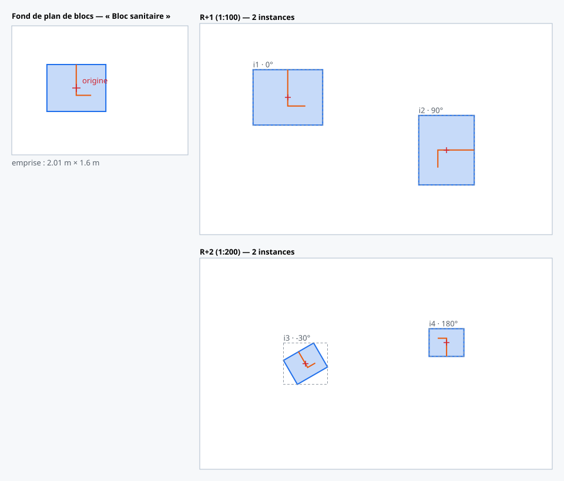

# Spec — Blocs d'annotations (« Bloc ») : définition unique, instances multiples

| | |
|---|---|
| **Feature** | Définir un groupe d'annotations comme un bloc et l'instancier N fois sur les fonds de plan, en 2D et en 3D |
| **Domaine** | `blocks` (+ `annotations`, `mapEditor`, `mapEditorGeneric`, `objectsLibrary`, `baseMaps`, `annotationTransform`) |
| **Branche** | `blocks_phase_1` |
| **Statut** | Phases 1 à 5 implémentées (2026-11-10), UI non testée. Phase 6 (optionnelle : `InstancedMesh`, exports) non commencée. |
| **Exemple de référence** | [`example-block.json`](example-block.json) → [`expected-render.svg`](expected-render.svg) |

> Le rendu attendu est **généré par l'implémentation réelle** via
> [`generateExpectedRender.mjs`](generateExpectedRender.mjs) : il importe les
> utils purs de `src/Features/blocks`. Si la géométrie des instances change, on
> régénère le SVG.

---

## 1. Contexte & problème

Un même ensemble d'annotations (un sanitaire, un poteau type, un détail
répété…) est aujourd'hui redessiné ou copié-collé à chaque emplacement. Les
copies sont indépendantes : une retouche oblige à corriger chaque copie, et
chaque copie est résolue, rendue et construite en 3D séparément.

## 2. Objectif

- Définir un **bloc** : un groupe nommé d'annotations, dessiné une seule fois.
- **Instancier** le bloc autant de fois que nécessaire, sur n'importe quel fond
  de plan, depuis l'éditeur 2D ou 3D.
- Une modification du bloc se **réplique immédiatement** sur toutes ses
  instances.
- Gagner en **performance de rendu** : la géométrie est construite une fois et
  référencée par les instances.

Vocabulaire : dans le code, toujours `block` (jamais `object`, déjà pris par
`OBJECT_3D` et les ouvrages). Dans l'UI : « Bloc ».

## 3. Scénarios utilisateur

1. **Créer un bloc** — Bibliothèque → Dessin → chip « Blocs » → « Nouveau
   bloc ». Le bloc est créé et son fond de plan de blocs s'ouvre.
2. **Dessiner le bloc** — sur le fond de plan de blocs, l'utilisateur dessine
   des annotations avec ses modèles habituels, les sélectionne, puis choisit le
   bloc dans le chip « Lier à un bloc » de la barre d'édition (à gauche de
   « Calque »).
3. **Positionner** — depuis la Bibliothèque, « Positionner sur le plan » arme la
   pose : le bloc suit le curseur à sa taille réelle, chaque clic dépose une
   instance, Échap termine.
4. **Manipuler une instance** — sélection d'un clic sur n'importe quelle
   annotation du bloc ; glisser pour déplacer, poignée pour tourner, commandes
   « Déplacer » / « Tourner » (y compris copies `*N`), suppression.
5. **Modifier le bloc** — barre d'édition de l'instance → « Modifier le bloc »
   ouvre le fond de plan de blocs. Toute retouche d'un membre est visible sur
   toutes les instances au retour.
6. **Créer un bloc depuis une sélection** — sur un fond de plan normal,
   « Lier à un bloc » → « Nouveau bloc… » déplace les annotations sur un fond
   de plan de blocs et laisse une instance à leur place : rien ne bouge à
   l'écran.
7. **Compléter un bloc depuis une instance** — sur un fond de plan normal,
   dessiner une annotation près d'une instance puis « Lier à un bloc » → ce
   bloc : l'annotation rejoint le bloc et apparaît sur toutes ses instances.

## 4. Exigences fonctionnelles

| # | Exigence | Phase |
|---|---|---|
| FR-01 | Les annotations membres vivent sur des **fonds de plan de blocs** (page blanche, hors des listes de fonds de plan). | 1 |
| FR-02 | Un fond de plan de blocs héberge plusieurs blocs ; un bloc peut avoir des membres sur plusieurs fonds de plan de blocs. | 1 (modèle), 4 (rendu 3D) |
| FR-03 | Le point d'insertion du bloc (`origin`) est fixé au premier lien, au centre des annotations liées, et ne bouge plus ensuite. | 1 |
| FR-04 | Les membres ne comptent pas dans les quantités du projet ; sur le fond de plan de blocs affiché, on voit les quantités du bloc. | 1 |
| FR-05 | Une instance ne copie aucune géométrie : référence au bloc + ancre + rotation + altitude. Pas de facteur d'échelle. | 2 |
| FR-06 | Une instance est dessinée à sa **taille réelle** quelle que soit l'échelle du fond de plan hôte. | 2 |
| FR-07 | L'édition d'un membre met à jour toutes les instances sans écrire une seule ligne d'instance. | 2 |
| FR-08 | Une instance se sélectionne, se déplace et se tourne comme un tout. | 2 |
| FR-09 | Pas d'instance sur un fond de plan de blocs (pas de blocs imbriqués). | 2 |
| FR-10 | « Lier à un bloc » depuis un fond de plan normal : déplacement + instance en place, sans saut visuel, un seul Ctrl+Z. | 3 |
| FR-11 | Instances visibles et manipulables en 3D ; géométrie et matériaux partagés. | 4 |
| FR-12 | Quantités = N instances × quantités du bloc, par modèle d'annotation. | 5 |

## 5. Modèle de données (Dexie v44)

```js
// db.blocks — "id,projectId,scopeId"
{ id, projectId, scopeId, label,
  origin: { baseMapId, x, y, z } | null } // x, y normalized on the origin
                                          // blocks base map, z in meters

// db.baseMaps — blocks base map (white page, no file)
{ isBlocksBaseMap: true, listingId: null, whitePage: {}, meterByPx, ... }

// db.annotations — MEMBER: any annotation drawn on a blocks base map
{ ..., baseMapId: <blocks base map>, blockId }

// db.annotations — INSTANCE
{ type: "BLOCK_INSTANCE", instanceOfBlockId, baseMapId,
  bbox: { x, y, width: 0, height: 0 }, // zero-size anchor, normalized
  rotation,                            // degrees, clockwise on screen
  offsetZ,                             // meters
  layerId, isTemplateless: true, scopeId, listingId: null }
```

Choix structurants :

- **`blockId` ≠ `instanceOfBlockId`** : deux champs distincts, indexés, pour
  qu'un membre et une instance ne soient jamais confondus.
- **Ancre `bbox` de taille nulle** : son centre est le point d'insertion. Tout
  le code existant des hôtes « bbox + rotation » (`OBJECT_3D`) s'applique tel
  quel, et l'emprise n'est jamais stockée : elle est dérivée du bloc au rendu,
  donc elle ne dérive pas quand le bloc change.
- **Instance = ligne sans modèle rattachée au Krto** (`isTemplateless` +
  `scopeId`) : elle passe les filtres de scope et les exports existants. Elle a
  sa propre sentinelle d'œil (`BLOCK_INSTANCES_TEMPLATE_ID`) et reste hors des
  lignes « Sans modèle ».
- **Fonds de plan de blocs partagés au niveau projet**, comme tout fond de
  plan ; les blocs, eux, appartiennent au Krto.

La table `blocks` est enregistrée dans : audit, soft delete, undo, export Krto
(+ fonds de plan de blocs et leurs versions), remap d'ids à l'import, export
projet, suppression locale, vidage et duplication de Krto.

## 6. Mécanisme de rendu

### 6.1 Repère du bloc

Le bloc a son propre repère, en **mètres**, d'origine le point d'insertion,
d'axes ceux de l'image du fond de plan d'origine (y vers le bas).

```
member px (origin base map) --scale(meterByPx) translate(-originPx)--> block frame (m)
block frame (m) --translate(anchorPx) rotate(rotation) scale(1 / hostMeterByPx)--> host px
```

Ces deux transformations sont produites par
`blocks/utils/blockInstanceGeometry.js` (`getBlockDefinitionTransform`,
`getBlockInstanceTransform`), testées en node.

### 6.2 2D — une définition, N `<use>`

- `BlockDefinitionsDefs` (monté une fois par l'éditeur 2D actif) rend chaque
  bloc **une seule fois** dans un `<svg><defs>` caché : un `<g id="block-def-…">`
  contenant les `NodeAnnotationStatic` des membres, exprimé dans le repère du
  bloc.
- `NodeBlockInstanceStatic` rend chaque instance comme **un seul `<use>`**
  pointant sur cette définition.
- **Coût React** : O(membres du bloc) au lieu de O(instances × membres).
- **Sélection** : la cible d'un événement pointeur sur un `<use>` est le
  `<use>` lui-même. Il porte `data-node-id` de l'instance, donc le hit-test
  DOM existant sélectionne l'instance entière, sans code spécifique.
- **État par instance** (survol, sélection, poignée de rotation, point
  d'insertion) : dessiné autour de l'emprise du bloc ; la définition partagée
  n'est jamais restylée.
- **Emprise** : `useBlockDefinitions` calcule `boundsM` par bloc et le publie
  dans `blockDefinitionsStore` ; les nœuds d'instance, le culling
  (`getAnnotationBbox`) et le lasso (`getAnnotationVertices`) le lisent.
- **Réplication (FR-07)** : modifier un membre re-résout ce seul membre dans
  `useBlockDefinitions`, re-rend un seul nœud dans `<defs>`, et le navigateur
  repeint tous les `<use>`.

### 6.3 « Lier à un bloc » depuis un fond de plan normal

`linkAnnotationsToBlockService` fait tout en **une transaction et un seul pas
d'undo** :

1. **Instantané** de la sélection (`buildPasteClipboard`, extrait du Ctrl+C de
   l'éditeur) : géométrie en pixels + centre de la sélection.
2. **Placement** (`getBlockLinkPlacement`, pur, testé en aller-retour) :

   | Cas | Où atterrissent les membres | Instance créée |
   |---|---|---|
   | Bloc sans origine (nouveau bloc) | À un emplacement libre du fond de plan de blocs (`findFreeSlotOnBlocksBaseMap`) ; le centre de la sélection **devient** l'origine | Oui, au centre de la sélection, rotation 0 |
   | Bloc avec origine + une instance sur ce fond de plan | Dans le repère de l'instance la plus proche (rotation et altitude inverses) | Non : toutes les instances les affichent déjà |
   | Bloc avec origine, aucune instance ici | Centre de la sélection ramené sur l'origine | Oui, au centre de la sélection |

3. **Déplacement** : `pasteAnnotationService` en mode `keepSourceIds`. La
   ligne garde son **id** (les liens vers ouvrages, zones, entité survivent),
   est reconstruite depuis la ligne stockée, reçoit de nouveaux points
   normalisés sur le fond de plan de blocs, et son calque est remis à
   « Calque 0 » (les calques sont propres à chaque fond de plan).
4. Écriture de `blockId` sur les lignes déplacées, puis création de
   l'instance.

Si aucun fond de plan de blocs n'a de place, un nouveau est créé (avant la
transaction : sa création n'est pas annulable).

### 6.4 Quantités des instances

Règle : **une instance compte pour une copie de chaque membre de son bloc**.
N instances d'un bloc = N × les quantités du bloc, ventilées par modèle
d'annotation.

Le calcul vit dans `useAnnotationsV2`, derrière l'option
`expandBlockInstances` (avec `withQties`) :

1. **Lecture** : les blocs du Krto, puis leurs instances dans le périmètre de
   la requête (fonds de plan demandés, dossiers masqués, calque de l'instance),
   puis les membres de ces blocs (filtrés par liste si la requête l'est).
2. **Pipeline normal** : les membres traversent les filtres habituels (œil de
   leur modèle, de leur liste, de leur calque) et reçoivent leurs quantités,
   calculées à l'échelle de leur fond de plan de blocs.
3. **Expansion** (`expandBlockInstancesForQties`, pur) : une **ligne
   virtuelle** par (instance, membre), d'id `<instanceId>::<memberId>`, qui
   porte le modèle et les quantités du membre sur le fond de plan et le calque
   de l'instance. Les membres présents uniquement pour alimenter le calcul
   sont retirés.

Une ligne virtuelle n'est pas une ligne de la base : elle ne se dessine pas
et ne s'écrit pas. Dans les listes, un clic dessus sélectionne son instance
(`getSelectableAnnotation`).

Appelants qui activent l'option : `useAnnotationTemplateQtiesById`,
`useAnnotationTemplateQtiesByIdForBaseMap`, `PopperMapListings`,
`PanelDrawing`, `PanelViewerAnnotations`, `PanelAnnotationTemplateProperties`.

La barre d'édition d'une instance affiche les totaux du bloc (une instance),
calculés par `useBlockDefinitions` (`sumBlockQties`).

### 6.5 3D — un prototype par bloc, des clones par instance

- **Prototypes hors scène** : `BlocksManager` possède une scène Three.js qui
  n'est jamais rendue ni interrogée par les lancers de rayon. Un second
  `AnnotationsManager` y construit les membres des blocs, chacun dans le
  repère de son fond de plan de blocs. Il réutilise donc tout le pipeline
  existant : constructeurs par type, diff incrémental, chargements
  asynchrones, découpe CSG, finitions, modes de rendu.
- **Instance** : `createAnnotationObject3D` crée pour `BLOCK_INSTANCE` un
  groupe vide posé comme un `OBJECT_3D` (centre de l'ancre, `-rotation` autour
  de Z local, `offsetZ`). `BlocksManager` le remplit avec
  `prototype.clone(true)` pour chaque membre : **géométries et matériaux
  partagés**.
- **Repère du bloc en 3D** : repère du fond de plan d'origine, translaté au
  point d'insertion. Un membre dessiné sur un autre fond de plan de blocs (une
  élévation) garde sa pose relative.
- **Sélection** : `nodeId` est retiré des clones, donc le picking remonte à la
  racine de l'instance.
- **Libération** : les clones portent `userData.sharedBlockResources` ;
  `AnnotationsManager` et le contrôleur de pose ne libèrent jamais leurs
  géométries ni leurs matériaux.
- **Réplication (FR-07)** : l'édition d'un membre reconstruit son seul
  prototype (diff incrémental), puis les instances sont re-remplies. Les
  fins de chargement asynchrone et de découpe CSG d'un membre re-remplissent
  les instances de ses blocs.
- **Alimentation** : `useAutoLoadAnnotationsInThreedEditor` appelle
  `threedEditor.loadBlockDefinitions` avec les mêmes options de construction
  que les annotations de la scène.
- **Pose en 3D** : même contrôleur que les objets 3D importés
  (`object3DPlacementController`, option `preview`) ; l'aperçu est un clone des
  prototypes. Déplacer / Tourner passent par `isBboxPlacedAnnotationType`.
- **Repère du bloc partagé** : le calcul du repère (matrice inverse du bloc,
  clones posés et marqués `sharedBlockResources`) vit dans
  `threedEditor/js/utilsBlocksManager/blockFrame.js`. `BlocksManager` et la
  construction hors scène d'une instance
  (`meshPaint/services/createHeadlessBlockPrototypes.js`) l'utilisent tous
  les deux : une instance construite hors scène a le même hash de géométrie
  que l'instance affichée.

### 6.6 Blocs créés par une procédure

Une procédure auto peut créer un bloc et ses instances (première utilisation :
les podiums de `PISCINE_INIT_V1`, un bloc « Podium » instancié par ligne de
nage) :

- le fond de plan de blocs est créé par `createBlocksBaseMapService`, qui
  accepte une taille et une échelle (`sideM`, `scale`) — une page de 3 m au
  1:10 pour un podium de 50 cm ;
- le bloc est créé vide (`createBlockService`) ; la procédure dessine son
  membre (`blockId` posé à la création), puis écrit `block.origin` : le point
  d'insertion est choisi par la procédure, pas le centre des membres ;
- les instances sont des lignes `BLOCK_INSTANCE` écrites telles quelles
  (ancre normalisée, rotation, `offsetZ`), marquées comme sorties de la
  procédure : un relancement les remplace, le bloc et ses membres restent ;
- une instance peut porter des peintures (`db.meshPaints`, voir
  `meshPaint/README.md` « Peintures créées par une procédure ») : les
  quantités peintes sont comptées par instance, sans passer par
  `expandBlockInstances`.

Ce que la V1 apporte : une seule construction de géométrie par bloc et des
tampons GPU partagés. Ce qu'elle n'apporte pas : la réduction du nombre de draw
calls (un par mesh et par instance). `InstancedMesh` reste une phase 6
optionnelle, à décider sur mesure.

## 7. Exemple de référence

Un bloc « Bloc sanitaire » (un polygone + une polyligne) et quatre instances
sur deux fonds de plan d'échelles différentes (1:100 et 1:200), avec des
rotations de 0°, 90°, −30° et 180°. Les rectangles pointillés sont les emprises
alignées sur les axes utilisées par le culling ; la croix rouge est le point
d'insertion.



À vérifier sur l'image : même taille réelle sur les deux plans (moitié moins de
pixels au 1:200), rotation positive dans le sens horaire à l'écran.

## 8. Cas limites & limitations (v1)

- **« Lier à un bloc » depuis un fond de plan normal** : limité aux surfaces,
  lignes, bandes et points d'un même fond de plan à l'échelle. Refusé pour les
  ouvertures et leurs hôtes, les mailles, et les annotations liées à une
  soustraction, à un maillage ou portant de la peinture.
- **Quantités non étendues aux instances** dans : exports Excel / PDF / DXF
  (`PanelPrint`), tableaux d'annotations (`TableAnnotations`,
  `PanelAnnotationsRecap`), ouvrages et lots (les liens portent sur des ids
  d'annotations réelles), propriétés de liste et de Krto, zones.
- **Soustractions 3D** : non déduites du total affiché sur la barre d'édition
  d'une instance.
- **Fond de plan de blocs affiché** : ses membres comptent pour eux-mêmes dans
  les totaux projet, en plus de leurs instances.
- **Bloc vide ou supprimé** : l'instance affiche un repère pointillé, reste
  sélectionnable et supprimable. Supprimer un bloc supprime ses instances et
  délie ses membres.
- **Membres sur un autre fond de plan de blocs que celui de l'origine** : non
  dessinés en 2D, construits en 3D.
- **3D — matériaux partagés** : un traitement qui modifie un matériau en place
  (au lieu de le remplacer) touche toutes les instances du bloc.
- **3D — accrochage** : les instances sont hors de l'index d'accrochage.
- **3D — bloc vide ou supprimé** : l'instance n'a rien de visible (pas de
  repère comme en 2D).
- **Calques** : un calque masqué sur le fond de plan de blocs masque le membre
  dans toutes les instances.
- **Hors éditeurs 2D et 3D** (grille de fonds de plan, portfolio, impression
  hors éditeur) : les définitions ne sont pas montées, les instances n'y sont
  pas dessinées.
- **Accrochage** : une instance n'offre que son point d'insertion.
- **Pas de commande pour redéfinir le point d'insertion** d'un bloc existant.
- **Export DXF** : instances ignorées.

## 9. Vérification

```bash
node --test src/Features/blocks/utils/blocksUtils.test.mjs
```

```bash
node specs/blocks/annotation-blocks/generateExpectedRender.mjs
```

```bash
npx vite build
```

Tests UI (à faire par l'utilisateur) : créer un bloc, lier deux annotations,
positionner deux instances sur deux fonds de plan d'échelles différentes,
modifier un sommet d'un membre → les instances suivent ; déplacer / tourner une
instance ; Ctrl+Z ; « Lier à un bloc » → « Nouveau bloc… » sur un fond de plan
normal (aucun saut visuel, puis Ctrl+Z) ; ajouter une annotation à un bloc
depuis une instance tournée ; en 3D (après rechargement complet) : instances
visibles, pose depuis la Bibliothèque, sélection, Déplacer / Tourner,
réplication d'une modification ; avec N instances, le total d'un modèle = ses
annotations hors blocs + N × celles du bloc (popper Dessin, panneau Dessin,
propriétés du modèle).

## 10. Fichiers impactés

- **Nouveau** : `src/Features/blocks/` — `utils/` (`blockTypes`,
  `blockInstanceGeometry`, `getBlockBoundsM`, `getBlockLinkPlacement`,
  `expandBlockInstancesForQties`, `sumBlockQties`, `getSelectableAnnotation`…),
  `js/blockDefinitionsStore.js`, `hooks/` (`useBlocks`, `useBlocksBaseMaps`,
  `useBlockDefinitions`, `usePlaceBlockInstance`, `useCommitBlockInstance`…),
  `services/` (`createBlockService`, `createBlocksBaseMapService`,
  `createBlockInstanceService`, `setAnnotationsBlockService`,
  `linkAnnotationsToBlockService`, `deleteBlockService`), `components/` (`SectionBlocksInLibrary`,
  `ChipBlockLink`, `BlockDefinitionsDefs`, `NodeBlockInstanceStatic`,
  `ToolbarEditBlockInstance`).
- **Schéma et registres** : `src/App/db/db.js`, `src/App/db/undoManager.js`,
  `krtoFile/services/createKrtoZip.js`, `krtoFile/utils/remapDexieExportIds.js`,
  `projects/services/*`, `scopes/services/clearScopeDataService.js`,
  `scopes/services/duplicateScopeService.js`.
- **Fonds de plan** : `baseMaps/js/BaseMap.js`, `baseMaps/hooks/useBaseMaps.js`.
- **Lecture** : `annotations/hooks/useAnnotationsV2.js` (résolution de l'ancre,
  exclusion des membres), `annotations/utils/templatelessAnnotations.js`,
  `getAnnotationBbox.js`, `getAnnotationVertices.js`.
- **Éditeur 2D** : `mapEditorGeneric/components/NodeAnnotationStatic.jsx`,
  `DrawingLayer.jsx`, `mapEditorGeneric/utils/applyDeltaPosToAnnotation.js`,
  `mapEditor/components/MainMapEditorV3.jsx`, `InteractionLayer.jsx`,
  `PopperEditAnnotation.jsx`, `mapEditor/hooks/useAnnotationDrag.js`.
- **Copier / déplacer** : `mapEditor/utils/buildPasteClipboard.js` (extrait
  d'`InteractionLayer.jsx`), `mapEditor/services/pasteAnnotationService.js`
  (option `keepSourceIds`).
- **Éditeur 3D** : `threedEditor/js/BlocksManager.js` (nouveau),
  `threedEditor/js/utilsBlocksManager/blockFrame.js` (repère du bloc, partagé
  avec `meshPaint/services/createHeadlessBlockPrototypes.js`),
  `ThreedEditor.js` (`loadBlockDefinitions`), `AnnotationsManager.js` (garde
  de libération), `utilsAnnotationsManager/createAnnotationObject3D.js`,
  `hooks/useAutoLoadAnnotationsInThreedEditor.js`,
  `services/object3DPlacementController.js`,
  `utils/object3DPlacementSelectors.js`,
  `blocks/hooks/useBlockInstancePlacementHandlers.js`.
- **Déplacer / Tourner** : `threedAnnotationMove/utils/annotationTransformTypes.js`
  (`isBboxPlacedAnnotationType`), `annotationTransform/utils/*`.
- **Quantités** : `annotations/hooks/useAnnotationTemplateQtiesById.js`,
  `useAnnotationTemplateQtiesByIdForBaseMap.js`,
  `annotations/utils/buildAnnotationSelectionItem.js`, `panelDrawing/*`,
  `mapEditor/components/PopperMapListings.jsx`.
- **UI** : `objectsLibrary/components/PanelObjectsLibrary.jsx`,
  `annotations/components/ToolbarEditAnnotation(s).jsx`.
